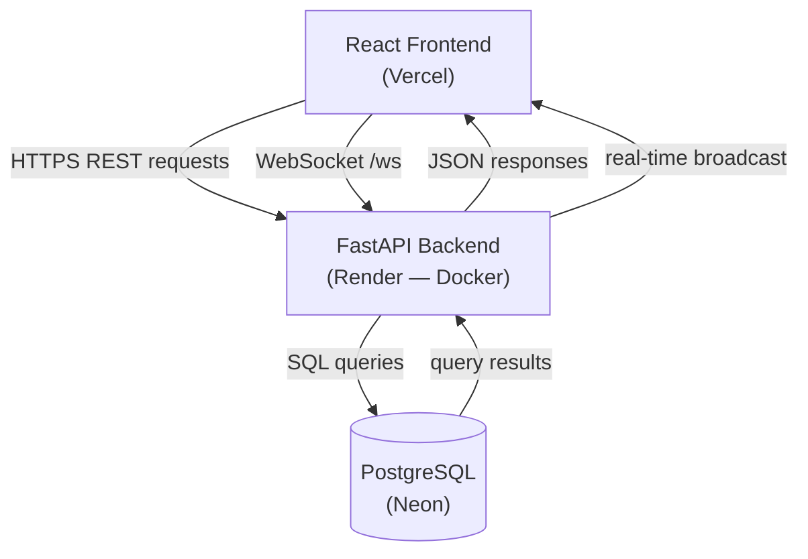
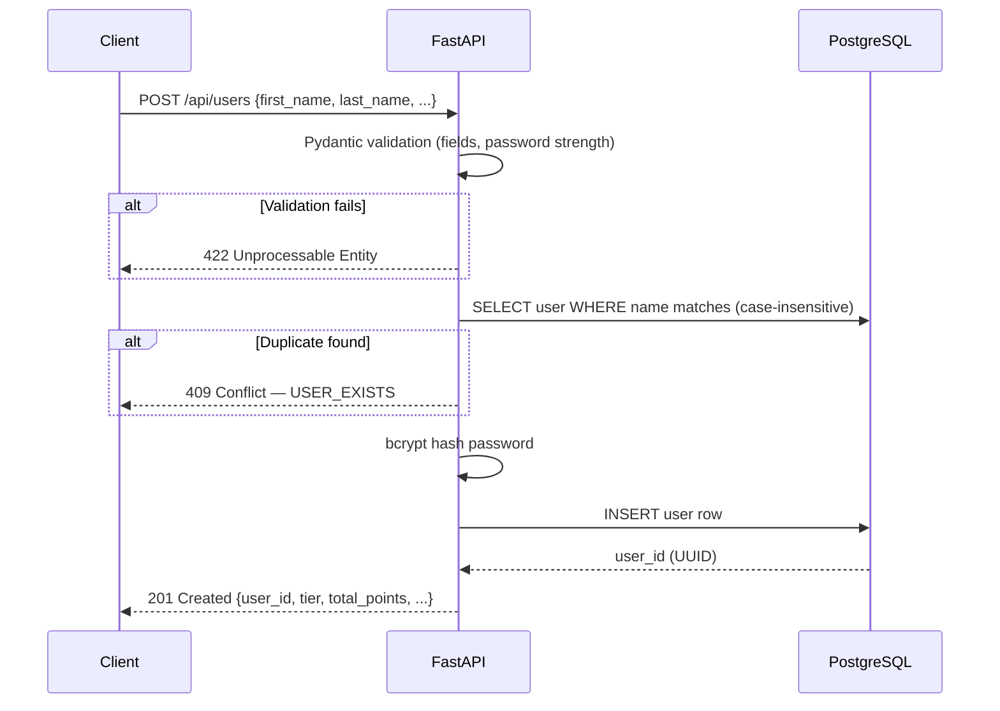
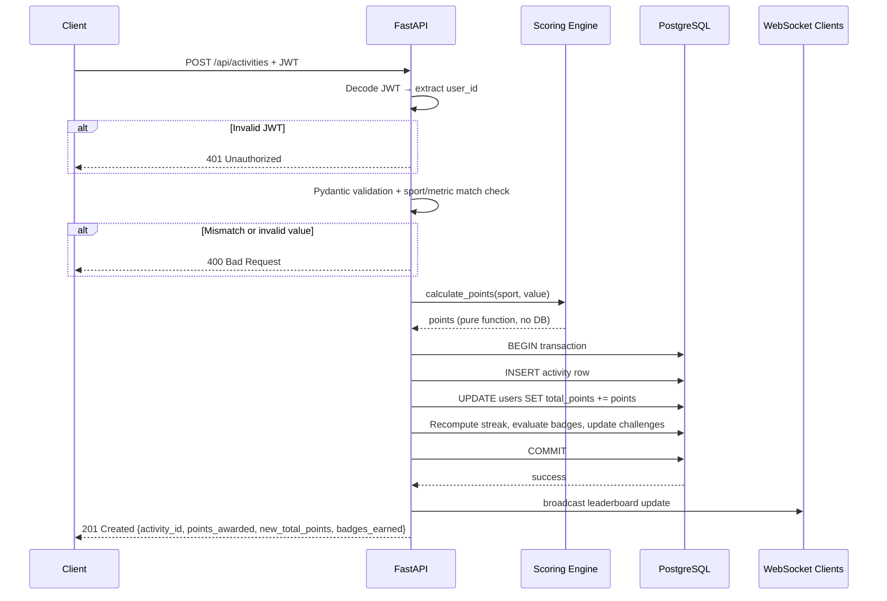

# DESIGN.md — Fitness Challenge Application

---

## a. System Architecture & Data Flow

### Overview



### Registration Request Flow



### Activity Ingestion Request Flow



---

## b. Database Schema & Data Model

### `users` table

| Column | Type | Constraints |
|---|---|---|
| `id` | `VARCHAR(36)` | Primary Key, UUID |
| `first_name` | `VARCHAR(50)` | NOT NULL |
| `last_name` | `VARCHAR(50)` | NOT NULL |
| `email` | `VARCHAR(255)` | NULL, unique (case-insensitive, partial index excluding NULLs) |
| `username` | `VARCHAR(30)` | NULL, unique (case-insensitive, partial index excluding NULLs) |
| `hashed_password` | `VARCHAR(255)` | NULL |
| `timezone` | `VARCHAR(50)` | Default `UTC` |
| `fitness_goal` | `INTEGER` | NULL, weekly points target |
| `bio` | `VARCHAR(160)` | NULL |
| `total_points` | `INTEGER` | Default `0`, indexed descending |
| `current_streak` | `INTEGER` | Default `0` |
| `last_active_date` | `DATE` | NULL |
| `badges` | `VARCHAR(2000)` | JSON array string, default `[]` |
| `created_at` | `TIMESTAMP` | Default UTC now |

**Duplicate detection:** A unique composite index on `lower(first_name), lower(last_name)` prevents registrations with the same name regardless of case. The application layer checks first and returns a clean `409` error message; the DB index is the race-condition guard.

---

### `activities` table

| Column | Type | Constraints |
|---|---|---|
| `id` | `VARCHAR(36)` | Primary Key, UUID |
| `user_id` | `VARCHAR(36)` | Foreign Key → `users.id` ON DELETE CASCADE, indexed |
| `sport` | `VARCHAR(20)` | indexed |
| `metric_type` | `VARCHAR(20)` | `distance_km` \| `duration_minsec` \| `count` |
| `raw_value` | `VARCHAR(20)` | Original value as submitted (e.g. `"45:30"`, `"5.2"`) |
| `normalized_value` | `FLOAT` | Floored value used for charts |
| `points_awarded` | `INTEGER` | indexed |
| `title` | `VARCHAR(100)` | NULL, HTML-stripped |
| `notes` | `VARCHAR(500)` | NULL, HTML-stripped |
| `location` | `VARCHAR(100)` | NULL, HTML-stripped |
| `source` | `VARCHAR(20)` | `manual` \| `apple_watch` \| `garmin` \| `fitbit` |
| `logged_at` | `TIMESTAMP` | indexed, must not be in the future |
| `created_at` | `TIMESTAMP` | Server-set |

There is no separate `leaderboard` table. Rankings are computed at query time using `ORDER BY total_points DESC` on the `users` table, supported by a descending index on `total_points`.

---

## c. API Specifications

### POST `/api/users` — Register

**Request body:**
```json
{
  "first_name": "Alice",
  "last_name": "Chen",
  "email": "alice@example.com",
  "username": "alice_chen",
  "password": "Secret123!",
  "timezone": "Asia/Kolkata",
  "fitness_goal": 500,
  "bio": "Running enthusiast"
}
```

Required: `first_name`, `last_name`. All other fields are optional.

**Validation rules:**
- `first_name`, `last_name`: 1–50 chars, no `< > & " '` characters
- `username`: 3–30 chars, lowercase alphanumeric and underscores only
- `password` (if provided): min 8 chars, must contain one uppercase letter, one digit, one special character
- `timezone`: must be a valid IANA timezone string
- `email`: valid email format, lowercased on store

**Success response `201`:**
```json
{
  "user_id": "550e8400-e29b-41d4-a716-446655440000",
  "first_name": "Alice",
  "last_name": "Chen",
  "username": "alice_chen",
  "total_points": 0,
  "current_streak": 0,
  "tier": "rookie",
  "created_at": "2026-10-10T04:30:00Z"
}
```

**Error responses:**
| Code | Condition |
|---|---|
| `422` | Pydantic validation failure (field missing, wrong format) |
| `409` | User with same first + last name already exists |
| `409` | Username or email already taken |

---

### POST `/api/activities` — Log Activity

Requires: valid JWT (`Authorization: Bearer <token>` or `access_token` cookie).

**Request body:**
```json
{
  "sport": "running",
  "metric": {
    "type": "distance_km",
    "value": 5.5
  },
  "logged_at": "2026-10-10T06:00:00Z",
  "title": "Morning run",
  "notes": "Felt good"
}
```

**Sport → metric type mapping (enforced, any mismatch returns `400`):**
| Sport | Required metric type | Value format |
|---|---|---|
| `running` | `distance_km` | float |
| `walking` | `distance_km` | float |
| `cycling` | `distance_km` | float |
| `gym` | `duration_minsec` | `"MM:SS"` string |
| `swimming` | `duration_minsec` | `"MM:SS"` string |
| `steps` | `count` | integer |

**Validation rules:**
- `sport` must be one of the 6 listed values
- `metric.type` must match the sport exactly
- `logged_at` must not be in the future
- `title`, `notes`, `location` are HTML-stripped

**Success response `201`:**
```json
{
  "activity_id": "uuid",
  "points_awarded": 550,
  "sport": "running",
  "metric_type": "distance_km",
  "normalized_value": 5.5,
  "new_total_points": 1250,
  "new_streak": 3,
  "badges_earned": [],
  "logged_at": "2026-10-10T06:00:00Z"
}
```

**Error responses:**
| Code | Condition |
|---|---|
| `400` | Invalid metric value for the sport |
| `400` | Sport/metric type mismatch |
| `401` | Missing or invalid JWT |
| `422` | Malformed request body |
| `429` | Rate limit exceeded (60 logs/hour/IP) |

---

## d. Scoring & Normalization Logic

All scoring is implemented as pure functions in `app/services/scoring.py` with no database dependencies, making it independently testable.

### Conversion rates

| Sport | Input unit | Points per unit |
|---|---|---|
| Running | km | 100 |
| Walking | km | 50 |
| Cycling | km | 25 |
| Swimming | minute | 15 |
| Gym | minute | 5 |
| Steps | 100 steps | 1 |

### Distance sports (Running, Walking, Cycling)

```
points = floor(km × rate)
```

Example: 1.55 km walking → `floor(1.55 × 50)` = `floor(77.5)` = **77 pts**

### Duration sports (Gym, Swimming)

Input format is `MM:SS`. Seconds are converted to total seconds, then floored to whole minutes before multiplication.

```
total_seconds = (minutes × 60) + seconds
whole_minutes = floor(total_seconds / 60)
points = whole_minutes × rate
```

Example: `1:55` gym → total 115s → `floor(115/60)` = 1 minute → `1 × 5` = **5 pts**

### Steps

Steps are floored to the nearest 100 before dividing.

```
floored = floor(steps / 100) × 100
points = (floored / 100) × 1
```

Example: 399 steps → `floor(399/100) × 100` = 300 → `300 / 100` = **3 pts**
Example: 99 steps → floored to 0 → **0 pts**

### Upper bounds (to prevent integer overflow)

| Sport | Max input |
|---|---|
| Running / Walking / Cycling | 1,000 km |
| Gym / Swimming | 999:59 |
| Steps | 200,000 |

Values above these limits return a `400` error.

---

## e. Frontend Architecture & Visualizations

The frontend is a React 18 + TypeScript single-page application built with Vite. Routing is handled by React Router v6. Server state (API data) is managed by TanStack React Query. Client state (logged-in user) is managed by Zustand.

### Page and component structure

```
src/
├── pages/
│   ├── LeaderboardPage.tsx   — global leaderboard table
│   ├── DashboardPage.tsx     — personal stats and charts
│   ├── LogActivityPage.tsx   — activity submission form
│   ├── ChallengesPage.tsx    — daily AI challenges
│   └── FriendsPage.tsx       — friend requests and feed
├── components/
│   ├── TierBadge.tsx         — tier label with colour
│   ├── StreakBadge.tsx       — streak flame display
│   └── Nav.tsx               — navigation bar
├── api/
│   └── endpoints.ts          — all Axios API calls
├── stores/
│   └── userStore.ts          — Zustand auth state
└── types/
    └── index.ts              — TypeScript interfaces
```

### Global Leaderboard

- Fetches `GET /api/leaderboard?limit=100&scope=global` on load.
- Displays rank (position in the returned array ordered by `total_points DESC`), name, tier badge, total points, and streak.
- Rank is computed server-side via `ORDER BY total_points DESC`. The position index in the response array is the rank.
- Real-time updates: a WebSocket connection to `/ws` receives broadcast events when any user logs an activity. On receipt, the leaderboard query is invalidated and refetched.
- Supports filtering by `scope=friends` (requires auth, shows only accepted friends).

### Personal Dashboard

Fetches `GET /api/dashboard/{user_id}` which returns aggregated stats, weekly point totals, and a 365-day heatmap array.

Visualizations rendered with Recharts and react-activity-calendar:

| Visualization | What it shows |
|---|---|
| Points over time (line chart) | Weekly point totals for the last 12 weeks |
| Sport breakdown (pie chart) | Session count per sport across all time |
| Activity calendar (heatmap) | 365-day rolling calendar, colour-coded by daily points |
| Tier progress bar | Points within current tier as a percentage toward next tier |
| Recent activity list | Last 20 activities with sport, value, points, and date |

---

## f. Trade-offs & Edge Cases

### No separate leaderboard table

Rankings are computed on query from `users.total_points` using `ORDER BY total_points DESC`. A descending index on `total_points` keeps this fast. The trade-off is that generating a paginated leaderboard requires a full index scan for deep pages, but at the current user scale this is acceptable. A materialized view or separate rank table would be the next step if latency became an issue.

### Denormalized `total_points` on the user row

`total_points` is stored on the `users` table and incremented atomically on each activity insert, rather than being summed from the `activities` table at query time. This avoids an aggregate query on every leaderboard load. The risk is that the counter can drift if an activity is deleted directly from the database; in practice, activities are not deleted through the API.

### Concurrent registrations with the same name

The app-level check (SELECT before INSERT) has a race window. A unique composite index on `lower(first_name), lower(last_name)` at the DB level handles this. Concurrent duplicate registrations will result in one succeeding and one receiving a `409` from the DB constraint, which the router catches and returns as a clean error.

### Sport/metric mismatch

Validated at the Pydantic `model_validator` level before the request reaches the router. A request for `gym` with `distance_km` is rejected with `400` before any DB access occurs.

### Duration input: MM:SS parsing

`"0:59"` is valid (0 minutes = 0 points). `"1:60"` is rejected (seconds must be 0–59). Negative minutes are rejected. Non-integer parts are rejected.

### Steps below 100

A submission of 99 steps awards 0 points, which is correct per the flooring rule. This is not treated as an error.

### Future-dated activities

`logged_at` is validated against the server's UTC clock at request time. Any timestamp in the future is rejected with `422`. This prevents pre-logging activities.

### Rate limiting

All write endpoints are rate-limited per IP using an in-process sliding window counter:
- Login: 30 attempts / 5 minutes
- Registration: 30 accounts / 1 hour
- Activity logging: 60 logs / 1 hour
- Insights: 30 requests / 1 hour

Rate limits are configurable via environment variables without a code change.

### AI insights fallback

Groq API calls for coaching insights are cached per user for 1 hour. On any API failure, the system returns a set of generic static tips and caches them with a near-expired timestamp so the next request retries Groq after ~5 minutes. The user always gets a response; the AI failure is never surfaced as an error.
